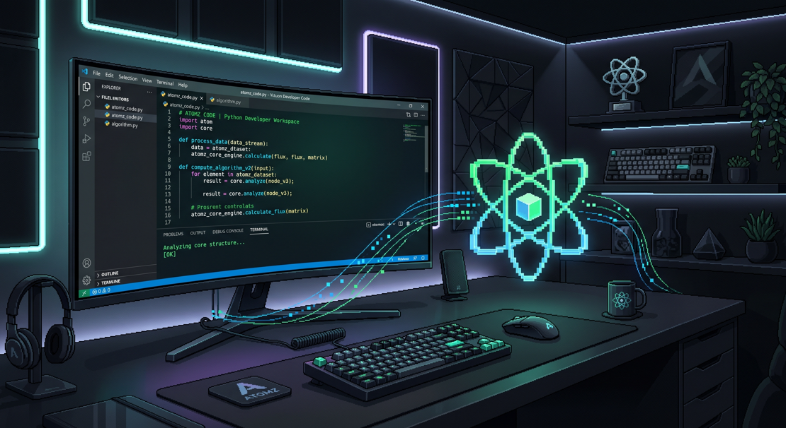

# ATOMZ LABS

**Software Engineering, Web Platforms & Automation Systems**

**هندسة البرمجيات، منصات الويب، وأنظمة الأتمتة الذكية**

 

---

### Overview | نبذة عامة

I design and build fast, reliable digital products—ranging from bilingual web platforms and client management systems to automated Telegram workflows and media engines. Focused on clean architecture, responsive UI, and practical business results.

أقوم بتصميم وتطوير حلول برمجية عملية وسريعة؛ بدايةً من منصات الويب التفاعلية وأنظمة الإدارة المخصصة، وصولاً إلى بوتات تليجرام وأدوات الأتمتة. تركيزي الأساسي على جودة الكود، سلاسة تجربة المستخدم، وحل المشاكل الفعلية للبيزنس.

---

### What We Build | مجالات العمل

<table width="100%">
  <tr>
    <td width="50%" valign="top">
      <b>Web Platforms & Dashboards</b> 
      Bilingual RTL/LTR web apps, conversion-focused landing pages, interactive calculators, and management tools.
      

         <b>منصات الويب ولوحات التحكم</b> 
        تطبيقات ويب ثنائية اللغة (عربي/إنجليزي)، وصفحات هبوط مصممة للتحويل، وحاسبات تفاعلية، وأدوات إدارة.
      

    </td>
    <td width="50%" valign="top">
      <b>Telegram Bots & Workflows</b> 
      Custom high-concurrency bots, media processing pipelines, database management, and broadcast systems.
      

         <b>بوتات تليجرام وأتمتة المهام</b> 
        بوتات مخصصة تتحمل ضغط الاستخدام العالي، ومعالجة الوسائط، وإدارة قواعد البيانات، وأنظمة الإذاعة.
      

    </td>
  </tr>
  <tr>
    <td width="50%" valign="top">
      <b>Scraping & Data Tools</b> 
      Browser automation with Playwright, session handling, and custom data pipelines.
      

         <b>استخراج ومعالجة البيانات</b> 
        أتمتة المتصفح باستخدام Playwright، وإدارة الجلسات، ومسارات بيانات مخصصة.
      

    </td>
    <td width="50%" valign="top">
      <b>Cross-Platform Apps</b> 
      React Native & Android applications tailored for clean user experiences.
      

         <b>تطبيقات الموبايل والأنظمة</b> 
        تطبيقات React Native وأندرويد مصممة لتجربة استخدام واضحة وبسيطة.
      

    </td>
  </tr>
</table>

---

### Selected Work | نماذج من الأعمال

| Project | Category | Tech Stack | Link / Status |
|---|---|---|---|
| **Coach Abdelrahman Darwish Platform** | Web Platform (AR/EN + Macro Lab) | `HTML5` `Tailwind` `JS` `GSAP` | [Live Site ↗](https://abdelrahman-darwish.pages.dev) |
| **Nazzel (@itNazzelBot)** | Telegram Media Engine | `Python` `Asyncio` `SQLite` | [Telegram Bot ↗](https://t.me/itNazzelBot) |
| **SnapFetch** | Multi-Platform Media Toolkit | `Python` `FFmpeg` | `Private Production` |
| **KORVO** | Full-Stack Web Application | `Next.js` `Node.js` | `In Development` |

---

### Tech Stack | التقنيات والأدوات

  
  
  
  
  
  
  
  
  
  
  

---

### Get in Touch | تواصل معي

<a href="https://t.me/AtomzAi">t.me/AtomzAi</a>

  

